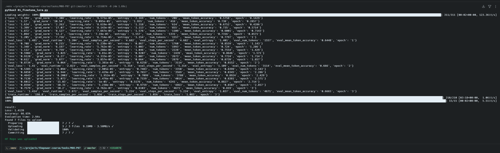
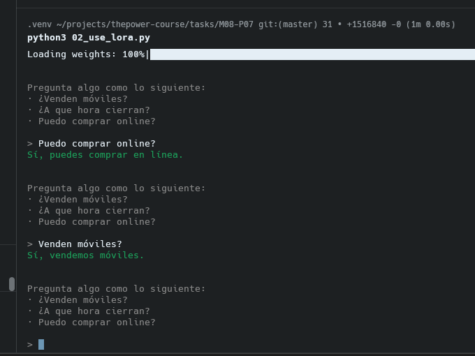

# Fine-tuning de Qwen3-0.6B con LoRA

Ajustamos `Qwen/Qwen3-0.6B` con LoRA para que responda preguntas sobre una tienda ficticia (**TechNova**) y luego lo probamos desde la terminal.

- `01_finetune_lora.py`: entrena el adaptador LoRA, lo evalúa, lo guarda y lo sube a Hugging Face.
- `02_use_lora.py`: carga el modelo base + el adaptador y abre un chat en la terminal.

## Preparación

```bash
python -m venv .venv
source .venv/bin/activate
pip install -r requirements.txt
cp .env.example .env
```

Variables de `.env`:

| Variable | Para qué sirve |
|---|---|
| `OPEN_MODEL_ID` | Modelo base (por defecto `Qwen/Qwen3-0.6B`) |
| `HF_REPO_ID` | Repo del adaptador en Hugging Face (`usuario/nombre`) |
| `HF_TOKEN` | Token de Hugging Face |
| `RESULTS_FOLDER` | Carpeta de checkpoints (por defecto `./lora`) |
| `RESULTS_FINAL_FOLDER` | Carpeta del adaptador final (por defecto `./lora-final`) |

## 01 · Entrenar

```bash
python 01_finetune_lora.py
```

Qué hace:

1. Lee `assets/example_questions_responses.csv` (columnas `prompt` y `completion`) y lo divide en train (70%), validación (15%) y test (15%).
2. Entrena con LoRA (`r=8`, `alpha=16`, sobre `q_proj`, `k_proj`, `v_proj`, `o_proj`) durante 3 épocas.
3. Evalúa e imprime loss y accuracy.
4. Guarda el adaptador en `lora-final/`.
5. Si hay `HF_REPO_ID` y `HF_TOKEN`, lo sube a un repo privado de Hugging Face.

Ejemplo del CSV:

```csv
prompt,completion
¿A qué hora cierran?,Cerramos a las 20:00 de lunes a sábado.
¿Abren los domingos?,"No, cerramos los domingos."
¿Cuánto cuesta el envío estándar?,El envío estándar cuesta 5 euros.
```

Resultado de la ejecución (~3 min):

```
result:
Loss: 1.4139
Accuracy: 66.65%
Evaluation time: 2.94s
HF Repo was uploaded
```



## 02 · Usar el adaptador

```bash
python 02_use_lora.py
```

Carga el modelo base y le aplica el adaptador desde `HF_REPO_ID`. Para usar el adaptador local, cambia la línea `PeftModel.from_pretrained(...)` por la que está comentada (usa `RESULTS_FINAL_FOLDER`).

Después escribe preguntas y el modelo responde. Pulsa `Ctrl+C` para salir.

Ejemplo:

```
> Puedo comprar online?
Sí, puedes comprar en línea.

> Venden móviles?
Sí, vendemos móviles.
```



## Archivos

- `01_finetune_lora.py`: entrenamiento y publicación.
- `02_use_lora.py`: chat con el adaptador.
- `colorize.py`: colores para la terminal.
- `assets/`: dataset y capturas.
- `lora-final/`: adaptador entrenado.
