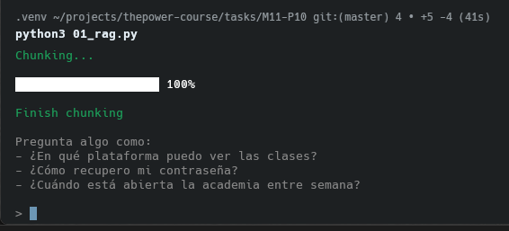
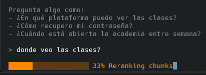
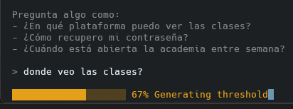
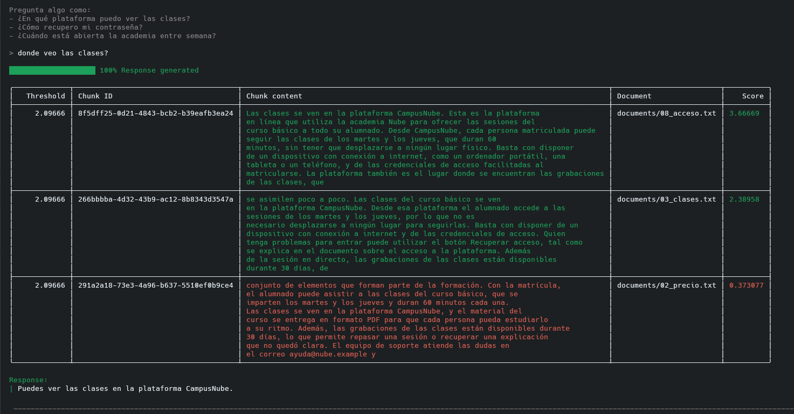
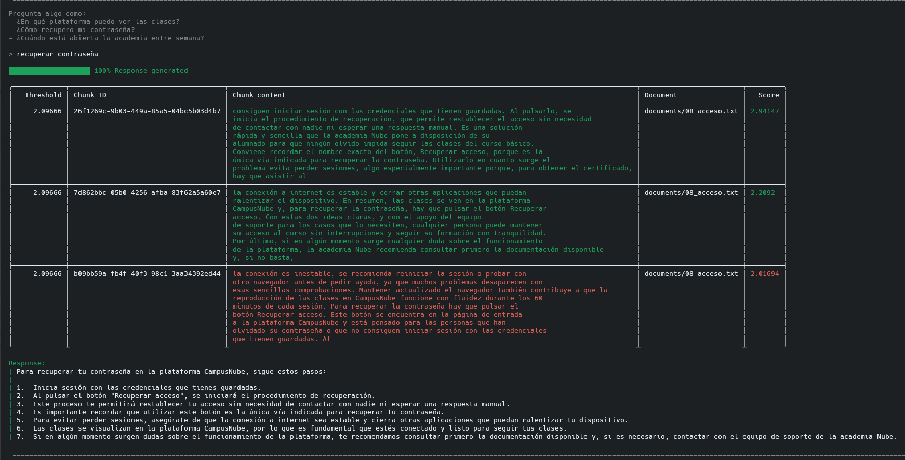
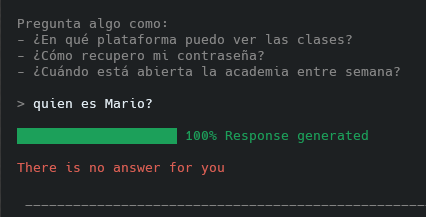

# 🤖 Chatbot RAG — M11-P10

Este proyecto responde preguntas sobre los ocho documentos ficticios de la academia Nube. Busca fragmentos relacionados con la pregunta y, si encuentra información suficiente, un modelo local redacta la respuesta.

## 🔄 ¿Qué hace el programa?

Al arrancar, lee los archivos de **documents/**, los divide en fragmentos con solapamiento, calcula sus embeddings y los guarda en PostgreSQL con pgvector.

Después, cada pregunta pasa por estos pasos:

1. 🔎 **Retrieve:** busca en la base de datos los fragmentos más cercanos a la pregunta.
2. 🏅 **Reranking:** vuelve a ordenar esos fragmentos según su relación con la pregunta.
3. 🚦 **Assess:** compara sus puntuaciones con un umbral calculado a partir de las preguntas de validación.
4. 💬 **Respuesta:** si hay fragmentos aceptados, envía su contenido y la pregunta a Ollama para generar una respuesta. Si no los hay, muestra un rechazo.

La barra de progreso de la terminal muestra por cuál de estos pasos va la pregunta. Cuando hay respuesta, la tabla enseña el umbral, los fragmentos, sus documentos y sus puntuaciones. Los fragmentos aceptados aparecen en verde y los descartados en rojo.

## ▶️ Ejecutarlo

Necesitas PostgreSQL con pgvector, Ollama con el modelo **llama3.2:3b**, las dependencias de **requirements.txt** y la configuración de conexión en **.env**, incluida **EMBEDDING_DIMENSIONS=384**. Desde esta carpeta:

~~~bash
pip install -r requirements.txt
ollama pull llama3.2:3b
python3 01_rag.py
~~~

## 🧪 Pruebas visuales

### 📥 Primera ejecución

Se preparan los fragmentos y aparece el campo para escribir una pregunta.

### ⏳ Pasos de una pregunta

La barra avanza mientras se ordenan los fragmentos y se calcula el umbral.

### ✅ Preguntas con respuesta

Estos ejemplos muestran los fragmentos recuperados, sus puntuaciones, el documento de origen y la respuesta generada.

### ❌ Pregunta sin información suficiente

Cuando ningún fragmento supera el umbral, el programa indica que no puede responder.

