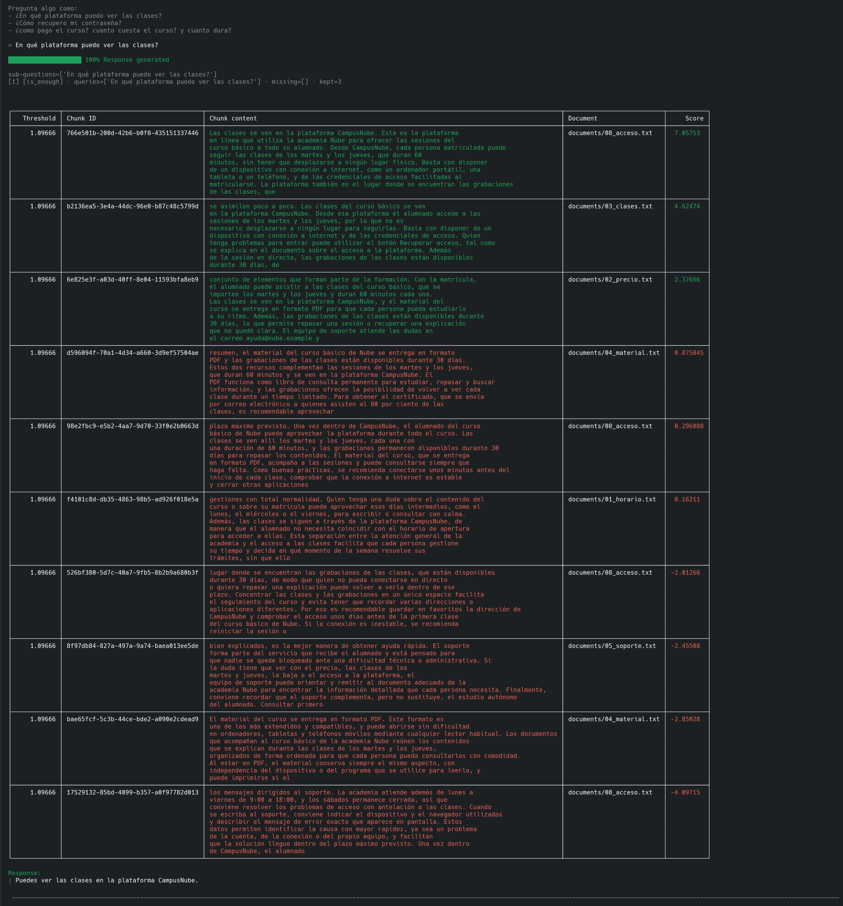
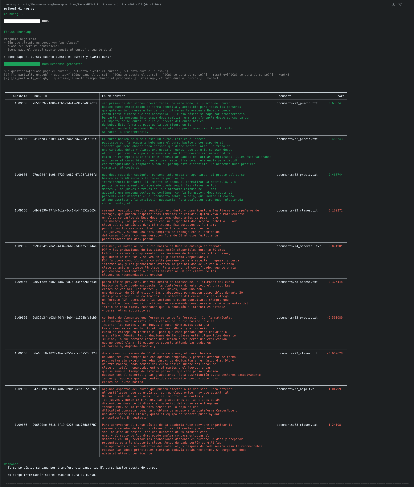

# 🤖 Chatbot CRAG — M12-P11

Responde preguntas sobre los documentos de la academia Nube. Antes de contestar, **comprueba si la información encontrada basta**. Si no basta, vuelve a buscar. Y si aun así falta algo, lo dice en lugar de inventarlo.

## 🔄 Cómo funciona

1. ✂️ **Separa la pregunta** en partes si trae varias (`¿cómo pago? ¿cuánto cuesta? ¿y cuánto dura?` → 3 preguntas).
2. 🔎 **Busca y reordena** los fragmentos de cada parte.
3. 🚦 **Evalúa** si cada parte tiene respuesta:
   - ✅ **Todas** → responde.
   - 🟡 **Algunas** → reformula las que faltan y vuelve a buscar (hasta 3 intentos).
   - ❌ **Ninguna** → rechaza la pregunta.
4. 💬 **Responde** solo con lo que encontró e indica lo que no sabe.

## ▶️ Ejecutarlo

~~~bash
pip install -r requirements.txt
ollama pull llama3.2:3b
python3 01_rag.py
~~~

## 🧪 Evidencias

### ✅ Toda la información encontrada

La pregunta se responde a la primera.

### 🟡 Información parcial

Responde cómo se paga y cuánto cuesta. Reformula la pregunta sobre la duración, sigue sin encontrarla y avisa: *"No tengo información sobre: ¿Cuánto dura el curso?"*.

