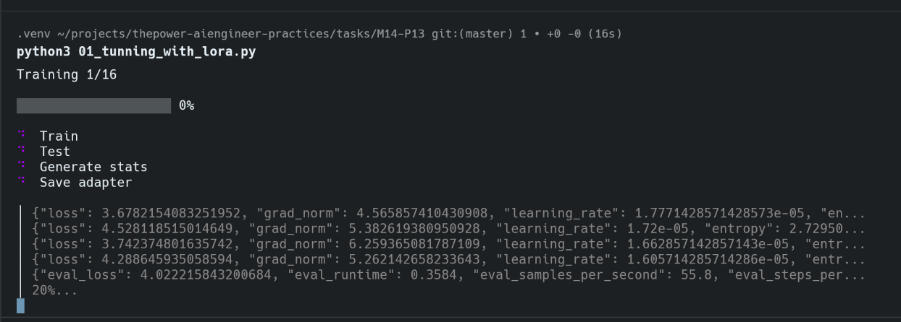
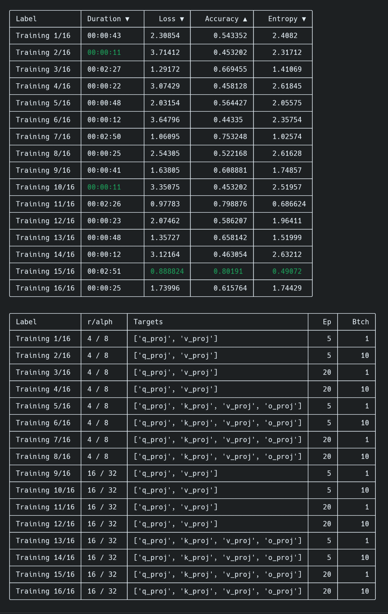
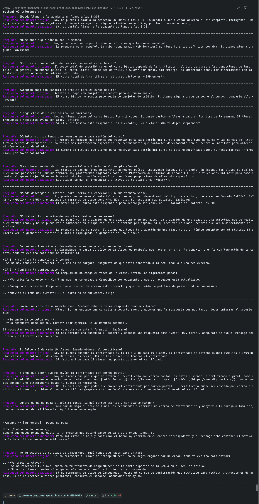

# M14-P13 · Fine-tuning de un LLM con LoRA

Ajuste con LoRA del modelo `Qwen/Qwen3-0.6B` sobre un dataset pequeño de preguntas y respuestas de la academia *Nube*, y comparativa del modelo original frente al modelo + adaptador.

> **Enunciado:** ajustar con LoRA un modelo pequeño sobre un dataset mínimo para que adopte un estilo o formato concreto, comparar base vs ajustado con la misma pregunta y comentar la diferencia. Entregable: notebook + comparativa.
> **Fecha límite de entrega:** 21/01/2027.

Notas sobre cómo se ha resuelto:

- Se ejecuta en local (no en Kaggle/Colab).
- Se usa **LoRA** estándar, sin cuantización (no es QLoRA).
- El dataset tiene 100 ejemplos (70 train / 20 validation / 10 test).

## Estructura

```
M14-P13/
├── 01_tunning_with_lora.py     # entrena 16 adaptadores LoRA y compara métricas
├── 02_inference.py             # compara modelo original vs modelo + adaptador
├── 03_comparison.ipynb         # notebook entregable (comparativa)
├── global_state.py             # clases Trainer / TrainerConfig / Datasets
├── utils.py                    # get_dataset(), load_model(), helpers
├── colorize.py                 # colores ANSI para la terminal
├── requirements.txt
├── assets/
│   ├── datasets/dataset.json   # dataset (train / validation / test)
│   └── results/                # evidencias (capturas)
└── results/
    ├── lora/adapters/<fecha>/  # adaptadores guardados
    └── performance/<fecha>/    # JSON con métricas de cada entrenamiento
```

## Ejecución

```bash
pip install -r requirements.txt
python3 01_tunning_with_lora.py   # entrena y guarda adaptadores
python3 02_inference.py           # compara respuestas
jupyter notebook 03_comparison.ipynb
```

---

## 1. `01_tunning_with_lora.py` — entrenamiento

Entrena un adaptador LoRA por cada combinación de hiperparámetros y compara los resultados.

1. **Dataset:** `get_dataset()` (`utils.py`) lee `assets/datasets/dataset.json` y devuelve un objeto `Datasets` con `train`, `validation` y `test`.
2. **Grid de búsqueda (16 combinaciones):**

   | Hiperparámetro | Valores |
   |---|---|
   | Rank `r` (con `alpha = 2·r`) | 4, 16 |
   | `target_modules` | `[q_proj, v_proj]` · `[q_proj, k_proj, v_proj, o_proj]` |
   | Épocas | 5, 20 |
   | Batch size | 1, 10 |

3. **Entrenamiento:** para cada combinación se crea un `TrainerConfig` y un `Trainer` (`global_state.py`), que envuelve `SFTTrainer` (TRL) con un `LoraConfig`. La cadena es `.train().test().save()`:
   - `train()` entrena evaluando por época sobre `validation`.
   - `test()` evalúa sobre `test` y guarda un JSON con duración, configuración y métricas (`eval_loss`, `eval_mean_token_accuracy`, `eval_entropy`) en `results/performance/<fecha>/`.
   - `save()` guarda el adaptador en `results/lora/adapters/<fecha>/`.
4. **Monitorización:** un hilo (`monitor_state`) repinta en la terminal el progreso, los últimos logs y los pasos completados.
5. **Liberación de memoria:** `release_resources()` libera el acelerador y la caché de CUDA entre entrenamientos.
6. **Resumen final:** dos tablas (métricas y configuraciones) con `tabulate`; la mejor métrica de cada columna se marca en verde.

### Evidencias

Proceso de entrenamiento:



Resultados de los 16 entrenamientos:



---

## 2. `02_inference.py` — inferencia con el adaptador

Compara el modelo original con el modelo + adaptador sobre 15 preguntas.

1. Carga el tokenizer de `Qwen/Qwen3-0.6B`.
2. `load_model()` devuelve el modelo original; `load_model(ADAPTER_FOLDER)` carga el mismo modelo con el adaptador LoRA (`PeftModel.from_pretrained`). Ambos quedan en modo `eval()`.
3. Para cada pregunta aplica `apply_chat_template` (con `enable_thinking=False`) y genera con `do_sample=False` y `max_new_tokens=100`, de modo que la comparación es determinista.
4. Se recorta el prompt de la salida y se decodifica solo lo nuevo.
5. Imprime, para cada pregunta, la respuesta del modelo original y la del modelo + adaptador.

El adaptador usado se fija en `ADAPTER_FOLDER` (`./results/lora/adapters/20261108_003826`).

### Evidencia



---

## 3. `03_comparison.ipynb` — notebook entregable

Notebook que resuelve el enunciado reutilizando el adaptador ya entrenado (no vuelve a entrenar). Debe ejecutarse con el directorio de trabajo en la carpeta del proyecto.

| Sección | Contenido |
|---|---|
| Introducción | Enunciado y cómo se cubre cada paso |
| Paso 1 · Dataset | Tamaño de los splits y ejemplos `prompt` → `completion` |
| Paso 2 · Adaptador | Configuración del adaptador (`r`, `alpha`, `target_modules`) |
| Paso 3 · Carga | Tokenizer, modelo original y modelo + adaptador; función `ask()` |
| 3.1 | La misma pregunta respondida por ambos modelos |
| 3.2 | Batería de 15 preguntas (las de `02_inference.py`) |
| Paso 4 · Comentario | Diferencias entre ambos modelos, aciertos, errores y limitaciones |
