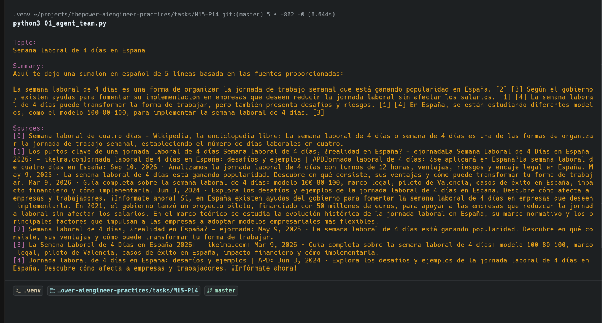

# M15-P14 · Equipo de 2 agentes con LangGraph

Ejercicio 1: un **investigador** busca en la web (DuckDuckGo) sobre la semana laboral de 4 días en España y un **redactor** escribe con esas fuentes un resumen de 5 líneas con citas `[n]`.

## Ejecución

```bash
ollama pull llama3.2:3b
pip install -r requirements.txt
python3 01_agent_team.py
```

## Cómo funciona

`START → researcher → writer → END`

- **Estado compartido:** `GlobalState` (`TypedDict`) con `question`, `sources` y `summary`.
- **Handoff:** el investigador escribe `sources` en el estado y el redactor las lee.
- **Barandilla:** la búsqueda se reintenta hasta 4 veces porque DuckDuckGo falla a ratos.

## Salida final



## Framework

Usé **LangGraph** porque, con dos agentes en secuencia, bastan dos nodos y una arista para que el orden quede explícito en el código. Además, el estado compartido deja ver exactamente qué le pasa el investigador al redactor.
