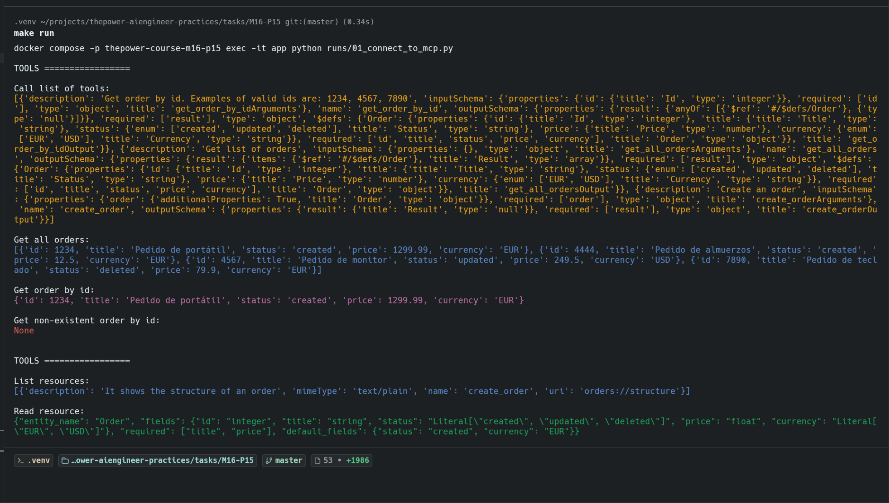
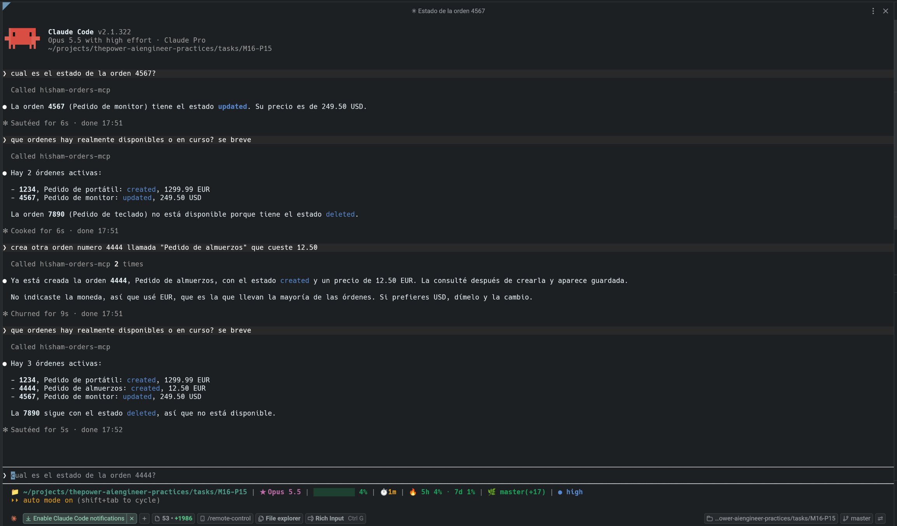

# 📦 Servidor MCP — M16-P15

Servidor MCP para consultar y crear órdenes 🛒, expuesto en `http://localhost:8000/mcp`.

## 🧰 Qué ofrece

- 🔧 **Tools:** `get_order_by_id`, `get_all_orders`, `create_order`
- 📄 **Resource:** `orders://structure` (estructura de una orden)

## 🚀 Uso

### 🏗️ Levantar el servidor

```bash
make start
```

Construye las imágenes y levanta la app + la base de datos 🐘 con Docker.

### ▶️ Probar con el cliente personalizado

```bash
make run
```

Ejecuta un cliente MCP propio 🐍 que lista las tools, consulta órdenes y lee el resource:



## 🤖 Uso desde Claude

Registra el servidor en Claude Code:

```bash
claude mcp add --transport http hisham-orders-mcp http://localhost:8000/mcp
```

Y pregúntale por tus órdenes en lenguaje natural 💬:


