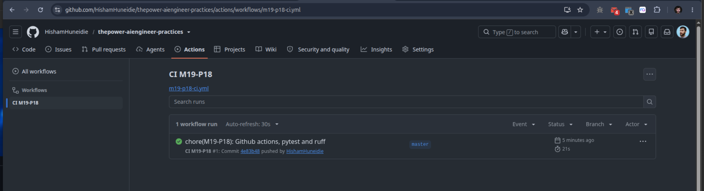

# M19-P18 · CI/CD

API de chat con FastAPI + Ollama (`llama3.2:3b`), con tests, linting y CI en GitHub Actions.

## Configuración

```bash
cp .env.example .env   # y rellena MODEL_ID=llama3.2:3b
```

## Comandos

| Acción          | Comando         |
|-----------------|-----------------|
| Levantar la app | `make start`    |
| Apagar la app   | `make stop`     |
| Validar (ruff)  | `make validate` |
| Lanzar tests    | `make test`     |

## Uso

Con la app levantada, en `http://localhost:8000`:

- `GET /health`: comprueba que la API responde.
- `POST /chat`: el LLM responde a un tema aleatorio.

## CI

El workflow [`m19-p18-ci.yml`](../../.github/workflows/m19-p18-ci.yml) ejecuta `ruff check` y `pytest` en cada push a `master` que toque esta tarea.


